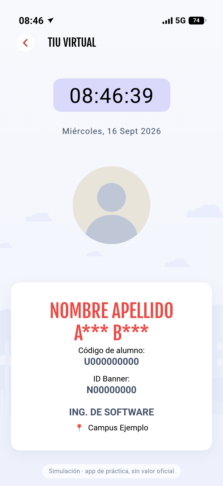

# TIU Virtual — recreación de la pantalla del carnet universitario

App web instalable (PWA) que reproduce, pantalla por pantalla, la vista "TIU Virtual":
reloj en vivo, fecha en español, foto circular y la tarjeta blanca con los datos del
alumno sobre el fondo ilustrado de nubes y campus.

<p align="center">
  
</p>

## Qué es y qué no es

Es un **ejercicio de interfaz**: todo lo que se ve está escrito en este repositorio y
sale de un archivo de configuración. No se conecta con ningún sistema académico, no
valida nada y no tiene forma de comprobar una matrícula. Por eso la pantalla lleva al
pie el sello "Simulación · app de práctica, sin valor oficial", que viene activado por
defecto (`showDemoBadge` en `src/config/card.ts`).

Dicho de otro modo: sirve para practicar layout, tipografía y PWAs; no sustituye ni
imita con validez el carnet real de una universidad.

## Correrla

```bash
npm install
npm run dev      # http://localhost:5173
```

Otros comandos:

```bash
npm run build         # genera dist/
npm run preview       # sirve dist/ en http://localhost:4173
npm run build:single  # dist/tiu-virtual.html, todo en un solo archivo
npm run typecheck     # TypeScript en modo estricto
```

`build:single` mete el JS, el CSS, las fuentes y la foto dentro de un único HTML
(~310 kB): se abre con doble clic, sin servidor. Sirve para mirar la pantalla rápido;
para instalarla como app hace falta servir `dist/` por HTTPS.

En pantallas grandes la app se dibuja dentro de una maqueta con forma de teléfono; en
un móvil ocupa todo el alto.

## Instalarla en el teléfono

La app es una PWA: se instala desde el navegador, sin tiendas ni certificados.

1. Publica `dist/` en cualquier hosting con HTTPS (GitHub Pages, Netlify, Vercel,
   Cloudflare Pages). Sin terminal: `netlify.com/drop` acepta que arrastres la carpeta
   `dist` (o un .zip con su contenido en la raíz) y devuelve una URL HTTPS al momento.
   Para probar en tu red local: `npm run dev -- --host` y entra desde el teléfono a
   `http://<ip-de-tu-pc>:5173`.
2. **iPhone (Safari)**: Compartir → "Añadir a pantalla de inicio".
3. **Android (Chrome)**: menú ⋮ → "Instalar aplicación".

Una vez instalada abre a pantalla completa, con su icono propio y sin barra de
navegador — la barra de estado simulada se oculta porque ahí va la real del sistema.
El service worker (`public/sw.js`) guarda los archivos, así que también abre sin
conexión.

## Cambiar los datos

Todo vive en `src/config/card.ts`:

```ts
export const config: AppConfig = {
  title: 'TIU VIRTUAL',
  student: {
    firstNames: 'NOMBRE APELLIDO',
    lastNames: 'A*** B***',
    studentCode: 'U000000000',
    bannerId: 'N00000000',
    program: 'ING. DE SOFTWARE',
    campus: 'Campus Ejemplo',
    photo: './avatar.jpg',
  },
  timeZone: 'America/Lima',
  locale: 'es-PE',
  showDemoBadge: true,
}
```

La foto es `public/avatar.jpg` (cuadrada; se recorta en círculo). En un sitio ya
publicado se puede cambiar sin volver a compilar: reemplaza el `avatar.jpg` que está en
la raíz de `dist/` y vuelve a publicar. El service worker sirve ese archivo con
estrategia de red primero y `_headers` lo marca como no cacheable, así el cambio se ve
en la siguiente carga en vez de quedarse pegado. El repositorio trae
una silueta genérica y datos de ejemplo a propósito: si pones datos personales
—nombre completo, códigos, tu foto— guárdalos en un repositorio **privado**. El reloj
usa `timeZone`, así que marca la hora de Lima aunque el teléfono esté en otro huso.

## Cómo se logró el parecido

Las medidas no son a ojo: se sacaron de la captura original (1206 × 2622 px, un
iPhone 16 Pro a 3×) analizando los píxeles, y cada elemento se comparó contra ese
objetivo hasta quedar dentro de ~2 px.

Las tipografías se identificaron igual de a la mala: se renderizaron los mismos textos
en dos docenas de familias, se normalizó cada muestra a la altura del original y se
comparó píxel a píxel. Public Sans ganó en las tres muestras (reloj, etiquetas y
códigos) por un margen de 3×, y Fjalla One en el nombre.

| Elemento | Valor |
| --- | --- |
| Lienzo de diseño | 402 × 874 pt |
| Pastilla del reloj | 211 × 60, radio 14, `#DAD9FC` |
| Foto | círculo de 140 px |
| Tarjeta | 362 de ancho, radio 16, `#FFFFFF` |
| Rojo del nombre | `#EB4B46` |
| Texto secundario | `#455168` |
| Tipografías | Fjalla One (títulos) · Public Sans (texto y reloj) |

Todas las medidas se escriben como `calc(N * var(--u))`, donde `--u` vale
`100vw / 402`. Así la pantalla se ve igual en cualquier ancho de teléfono en lugar de
recolocarse con breakpoints.

## Estructura

```
src/
  App.tsx                 armado de la pantalla
  config/card.ts          datos y opciones
  components/
    SkyBackground.tsx     fondo SVG (nubes + campus)
    StatusBar.tsx         barra de estado simulada (solo en navegador)
    AppHeader.tsx         botón atrás + título
    ClockChip.tsx         reloj en vivo + fecha
    Avatar.tsx            foto circular
    IdCard.tsx            tarjeta blanca
  hooks/useNow.ts         tick de 1 s, re-sincronizado al volver del fondo
  lib/datetime.ts         formato "08:46:38" y "Miércoles, 16 Sept 2026"
  styles.css              todas las medidas del diseño
scripts/make-icons.mjs    regenera public/icons con Playwright
```

## Detalles que vale la pena mirar

- **El reloj no usa `setInterval`.** Cada tick se programa contra el borde del segundo
  y se re-sincroniza cuando la app vuelve del segundo plano, así no se desfasa.
- **Fecha determinista.** Los meses y días salen de una tabla propia ("Sept", no
  "Set") para que no cambien según cómo resuelva el locale cada navegador.
- **Fuentes locales.** Public Sans y Fjalla One se sirven desde `src/assets/fonts`, sin
  pedirle nada a Google Fonts: la app arranca igual sin conexión.
- **Cifras proporcionales en el reloj.** En el video original el ancho del reloj cambia
  según los dígitos (128 px en `08:47:11`, 148 px en `08:47:28`), así que las cifras no
  son tabulares y aquí tampoco lo son.
